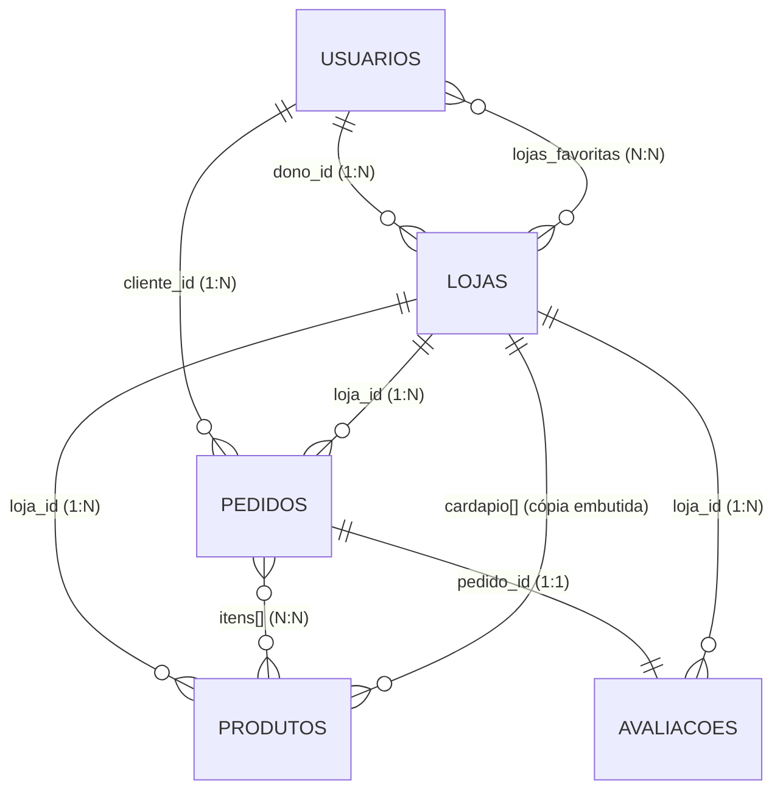

# Checkpoint 1 — Domingueira: modelagem de dados no MongoDB

> **Banco de Dados NoSQL (TSI34E-TSI4) · UTFPR Guarapuava**
> Como rodar: `./iniciar.sh` → o `init/mongo-init.js` cria as coleções, os índices e os dados (7 usuários, 5 lojas, 15 produtos, 8 pedidos, 6 avaliações = **41 documentos**). A API sobe em `http://localhost:3400`.

---

## 1. Tema e escopo do sistema

**Domingueira** é um marketplace de **assados e comidas de fim de semana de produtores locais de Guarapuava-PR**: frango assado no forno a lenha, costela de fogo de chão, porco no rolete, cucas, queijos coloniais e marmitas rurais. Quem vende são pequenos produtores e churrasqueiros que só funcionam no sábado e no domingo, em fornadas limitadas. Hoje eles vendem por grupos de WhatsApp: o cliente manda mensagem, o dono anota em papel, o estoque acaba sem aviso e ninguém sabe quanto faturou. Essa informalidade é o problema real que o sistema resolve.

Os usuários principais são os **donos de loja** (cadastram o cardápio, controlam fornada e estoque, acompanham pedidos e faturamento) e os **clientes** (descobrem lojas próximas que realmente entregam no endereço deles, montam o carrinho, pedem e avaliam). A plataforma cobra uma pequena taxa percentual por loja sobre os pedidos entregues.

O domínio é diferente de um delivery gastronômico tradicional por quatro razões que forçam decisões de modelagem: (1) **venda por peso variável** (`PESO` com peso médio por peça, ao lado de `UNIDADE`); (2) **estoque por fornada**, não por prateleira; (3) **atributos que mudam por produto** (a costela tem `horas_no_fogo`, o frango tem `recheio`), o que casa com o modelo flexível de documentos; (4) **janela de atendimento restrita ao fim de semana**, com raio de entrega e pedido mínimo próprios de cada loja.

**Por que NoSQL (MongoDB):** os produtos têm esquemas heterogêneos; a tela da loja precisa do cardápio inteiro numa única leitura (documento agregado); o pedido guarda um *snapshot* imutável dos preços; há consultas geoespaciais (`2dsphere`) para "quem entrega aqui"; e o modelo de documentos evita `JOIN`s nas telas mais acessadas, que são todas de leitura.

---

## 2. Entidades e coleções

Banco: `domingueira`. Seis coleções (cinco de domínio e uma técnica de sincronização, usada no Checkpoint 2).

### 2.1 `usuarios`
| Campo | Tipo BSON | Observação |
|---|---|---|
| `_id` | ObjectId | |
| `nome` | String | |
| `email` | String | índice único |
| `telefone` | String | |
| `papel` | String | `CLIENTE` ou `DONO` |
| `enderecos` | Array de Subdocumento | **composto**: `apelido` (String), `logradouro`, `numero`, `bairro`, `cidade`, `uf` (String), `localizacao` (GeoJSON Point) |
| `lojas_favoritas` | Array de ObjectId | referências a `lojas` |
| `criado_em` | Date | |

### 2.2 `lojas`  (entidade central)
| Campo | Tipo BSON | Observação |
|---|---|---|
| `_id` | ObjectId | |
| `nome`, `slug`, `whatsapp` | String | `slug` com índice único |
| `dono_id` | ObjectId | ref. `usuarios` |
| `ativa` | Boolean | |
| `taxa_plataforma_percentual` | Number (Double) | |
| `endereco` | Subdocumento | `logradouro`, `numero`, `bairro`, `cidade`, `uf` (String) e `localizacao` (GeoJSON Point, índice `2dsphere`) |
| `atendimento` | Subdocumento | `retirada` (Boolean); `entrega` (Subdocumento: `ativa` Boolean, `raio_km`, `taxa`, `pedido_minimo` Number) |
| `horarios` | Array de Subdocumento | `dia` (String), `abre`, `fecha` (String) |
| `cardapio` | Array de Subdocumento | **composto**: `produto_id` (ObjectId), `nome` (String), `venda` (Subdocumento `tipo`, `preco` ou `preco_kg` + `peso_medio_kg`), `estoque.limitado` (Boolean), `detalhes` (Subdocumento livre), `ativo` (Boolean) |
| `avaliacao_resumo` | Subdocumento | `total`, `soma_notas` (Int), `media` (Double) |
| `criada_em`, `atualizada_em` | Date | |

### 2.3 `produtos`
| Campo | Tipo BSON | Observação |
|---|---|---|
| `_id` | ObjectId | |
| `loja_id` | ObjectId | ref. `lojas` |
| `nome`, `categoria`, `descricao` | String | |
| `ingredientes`, `alergenos` | Array de String | |
| `venda` | Subdocumento | `tipo` (`UNIDADE`/`PESO`), `preco` (Double) ou `preco_kg` + `peso_medio_kg` |
| `estoque` | Subdocumento | `limitado` (Boolean), `quantidade` (Int ou Null) |
| `detalhes` | Subdocumento | atributos específicos do produto (opcional) |
| `ativo` | Boolean | |
| `criado_em`, `atualizado_em` | Date | |

### 2.4 `pedidos`
| Campo | Tipo BSON | Observação |
|---|---|---|
| `_id` | ObjectId | |
| `cliente_id`, `loja_id` | ObjectId | referências |
| `loja_nome` | String | cópia do nome na data do pedido |
| `tipo_entrega` | String | `ENTREGA` ou `RETIRADA` |
| `endereco_entrega` | Subdocumento ou Null | **snapshot** do endereço |
| `itens` | Array de Subdocumento | **composto**: `produto_id` (ObjectId), `nome` (String), `tipo_venda` (String), `quantidade` (Number), `preco_unitario` (Double), `subtotal` (Double) |
| `subtotal`, `taxa_entrega`, `total` | Number (Double) | |
| `status` | String | `PENDENTE`, `CONFIRMADO`, `PRONTO`, `ENTREGUE`, `CANCELADO` |
| `historico` | Array de Subdocumento | `status` (String), `em` (Date) |
| `pagamento` | Subdocumento | `forma`, `status` (String) |
| `criado_em`, `atualizado_em` | Date | |

### 2.5 `avaliacoes`
| Campo | Tipo BSON | Observação |
|---|---|---|
| `_id` | ObjectId | |
| `pedido_id` | ObjectId | ref. `pedidos`, índice único (1 avaliação por pedido) |
| `loja_id`, `cliente_id` | ObjectId | referências |
| `nota` | Int | 1 a 5 |
| `comentario` | String | |
| `resposta_loja` | Subdocumento (opcional) | `texto` (String), `em` (Date) |
| `criada_em` | Date | |

### 2.6 `sync_pendentes` (técnica, Checkpoint 2)
`produto_id` (ObjectId, único), `erro` (String), `tentativas` (Int), `criado_em`, `ultima_tentativa` (Date). Fila de reindexações do Elasticsearch que falharam.

---

### 2.7 `entregadores` (adicionada no Checkpoint 3)
`_id` (ObjectId), `nome`, `veiculo`, `telefone` (String), `ativo` (Boolean), `criado_em` (Date). Cadastro durável; a posição em tempo real fica no Redis (ver `CHECKPOINT_3.md`).

---

## 3. Embedding vs. Referencing

| Relacionamento | Decisão | Justificativa técnica |
|---|---|---|
| Loja → endereço, atendimento, horários | **Embedding** | 1:1 e 1:poucos; sempre lidos junto com a loja; nunca consultados isoladamente; tamanho limitado e estável. |
| Usuário → endereços | **Embedding** | Um cliente tem poucos endereços (< 10) e só os lê no próprio contexto. O pedido faz cópia do endereço usado. |
| Loja → cardápio (resumo) | **Embedding** (cópia resumida) | A tela da loja é a mais acessada e precisa do cardápio inteiro numa única leitura. O cardápio de um produtor local tem dezenas de itens, muito abaixo do limite de 16 MB. É o *Extended Reference Pattern*: só nome, preço, ativo; a descrição longa fica em `produtos`. |
| Loja → produtos (catálogo completo) | **Referencing** (`produtos.loja_id`) | O catálogo completo tem descrição, ingredientes e estoque, que mudam com frequência e são buscados de forma independente (filtros, busca). Mantê-lo separado evita reescrever o documento da loja a cada ajuste de estoque. |
| Pedido → itens | **Embedding** + snapshot de nome e preço | Itens só existem dentro do pedido e são sempre lidos com ele. O preço copiado dá **imutabilidade histórica**: reajustar o produto não altera pedidos antigos. Crescimento limitado (poucos itens por pedido). |
| Pedido → histórico de status | **Embedding** | Array pequeno, só cresce por `$push` e é lido com o pedido. |
| Pedido → cliente e loja | **Referencing** + `loja_nome` copiado | Cliente e loja têm vida própria. A cópia do nome evita `$lookup` na listagem do histórico (tela mobile). |
| Loja → pedidos | **Referencing** (`pedidos.loja_id`) | Cardinalidade **ilimitada** (cresce todo fim de semana). Embutir estouraria o limite de 16 MB e geraria documentos gigantes. |
| Loja → avaliações | **Referencing** + `avaliacao_resumo` embutido | Avaliações crescem sem limite. O resumo (total, soma, média) é um *Computed Pattern* e dá a nota na tela da loja sem agregar. |
| Usuário ↔ Loja (favoritas) | **Referencing** (array de ObjectId) | N:N com cardinalidade baixa de um dos lados; array de referências no lado que cresce pouco. |
| Dono → lojas | **Referencing** (`lojas.dono_id`) | Um dono pode ter várias lojas; a loja é o lado "muitos". |

---

## 4. Relacionamentos e cardinalidade

| Relação | Cardinalidade | Chave |
|---|---|---|
| Dono (`usuarios`) → Loja | **1:N** | `lojas.dono_id` |
| Loja → Produto | **1:N** | `produtos.loja_id` |
| Cliente → Pedido | **1:N** | `pedidos.cliente_id` |
| Loja → Pedido | **1:N** | `pedidos.loja_id` |
| Pedido → Item | **1:N** (embutido) | `pedidos.itens[]` |
| Pedido → Avaliação | **1:1** | `avaliacoes.pedido_id` (índice único) |
| Loja → Avaliação | **1:N** | `avaliacoes.loja_id` |
| Cliente ↔ Loja (favoritas) | **N:N** | `usuarios.lojas_favoritas[]` |
| Cliente ↔ Loja (compras) | **N:N** (via `pedidos`) | `pedidos.cliente_id` + `pedidos.loja_id` |
| Produto ↔ Pedido | **N:N** (via `pedidos.itens[]`) | `itens.produto_id` |



---

## 5. Exemplos de documentos (JSON estendido do MongoDB)

**usuarios**
```json
{
  "_id": {"$oid": "670a1b9d8f3b4a5d6e7f8910"},
  "nome": "Mariana Souza",
  "email": "mariana.souza@email.com",
  "telefone": "42991110001",
  "papel": "CLIENTE",
  "enderecos": [
    {"apelido": "Casa", "logradouro": "Rua Visconde de Guarapuava", "numero": "320", "bairro": "Centro", "cidade": "Guarapuava", "uf": "PR",
     "localizacao": {"type": "Point", "coordinates": [-51.4625, -25.3948]}}
  ],
  "lojas_favoritas": [{"$oid": "670a1c2e8f3b4a5d6e7f8a01"}, {"$oid": "670a1c2e8f3b4a5d6e7f8a03"}],
  "criado_em": {"$date": "2026-09-01T15:00:00Z"}
}
```

**lojas**
```json
{
  "_id": {"$oid": "670a1c2e8f3b4a5d6e7f8a01"},
  "nome": "Assados do Trianon",
  "slug": "assados-do-trianon",
  "dono_id": {"$oid": "670a1b9d8f3b4a5d6e7f8900"},
  "whatsapp": "42999123456",
  "ativa": true,
  "taxa_plataforma_percentual": 1.5,
  "endereco": {"logradouro": "Rua das Araucárias", "numero": "1450", "bairro": "Trianon", "cidade": "Guarapuava", "uf": "PR",
               "localizacao": {"type": "Point", "coordinates": [-51.4582, -25.3921]}},
  "atendimento": {"retirada": true, "entrega": {"ativa": true, "raio_km": 4.5, "taxa": 7.0, "pedido_minimo": 50.0}},
  "horarios": [{"dia": "SABADO", "abre": "08:00", "fecha": "13:30"}, {"dia": "DOMINGO", "abre": "08:00", "fecha": "13:00"}],
  "cardapio": [
    {"produto_id": {"$oid": "670a1d4f8f3b4a5d6e7f8b01"}, "nome": "Frango assado inteiro",
     "venda": {"tipo": "UNIDADE", "preco": 52.0}, "estoque": {"limitado": true},
     "detalhes": {"recheio": "Farofa de miúdos", "tempero": "Alho e limão"}, "ativo": true},
    {"produto_id": {"$oid": "670a1d4f8f3b4a5d6e7f8b02"}, "nome": "Costela bovina fogo de chão",
     "venda": {"tipo": "PESO", "preco_kg": 84.9, "peso_medio_kg": 1.8}, "estoque": {"limitado": true},
     "detalhes": {"corte": "Janela", "horas_no_fogo": 8}, "ativo": true}
  ],
  "avaliacao_resumo": {"total": 132, "soma_notas": 621, "media": 4.7},
  "criada_em": {"$date": "2026-08-14T13:20:00Z"},
  "atualizada_em": {"$date": "2026-09-29T21:14:08Z"}
}
```

**produtos**
```json
{
  "_id": {"$oid": "670a1d4f8f3b4a5d6e7f8b02"},
  "loja_id": {"$oid": "670a1c2e8f3b4a5d6e7f8a01"},
  "nome": "Costela bovina fogo de chão",
  "categoria": "Carnes",
  "descricao": "Costela bovina assada por 8 horas no fogo de chão, macia e que desmancha no garfo.",
  "ingredientes": ["costela bovina", "sal grosso"],
  "alergenos": [],
  "venda": {"tipo": "PESO", "preco_kg": 84.9, "peso_medio_kg": 1.8},
  "estoque": {"limitado": true, "quantidade": 12},
  "detalhes": {"corte": "Janela", "horas_no_fogo": 8},
  "ativo": true,
  "criado_em": {"$date": "2026-08-20T12:00:00Z"},
  "atualizado_em": {"$date": "2026-09-29T21:14:08Z"}
}
```

**pedidos**
```json
{
  "_id": {"$oid": "670a30008f3b4a5d6e7f8c01"},
  "cliente_id": {"$oid": "670a1b9d8f3b4a5d6e7f8910"},
  "loja_id": {"$oid": "670a1c2e8f3b4a5d6e7f8a01"},
  "loja_nome": "Assados do Trianon",
  "tipo_entrega": "ENTREGA",
  "endereco_entrega": {"logradouro": "Rua Visconde de Guarapuava", "numero": "320", "bairro": "Centro", "cidade": "Guarapuava", "uf": "PR",
                       "localizacao": {"type": "Point", "coordinates": [-51.4625, -25.3948]}},
  "itens": [
    {"produto_id": {"$oid": "670a1d4f8f3b4a5d6e7f8b01"}, "nome": "Frango assado inteiro", "tipo_venda": "UNIDADE", "quantidade": 1, "preco_unitario": 52.0, "subtotal": 52.0},
    {"produto_id": {"$oid": "670a1d4f8f3b4a5d6e7f8b03"}, "nome": "Maionese caseira 500 g", "tipo_venda": "UNIDADE", "quantidade": 1, "preco_unitario": 16.0, "subtotal": 16.0}
  ],
  "subtotal": 68.0, "taxa_entrega": 7.0, "total": 75.0,
  "status": "ENTREGUE",
  "historico": [
    {"status": "PENDENTE", "em": {"$date": "2026-10-17T15:10:00Z"}},
    {"status": "CONFIRMADO", "em": {"$date": "2026-10-17T15:35:00Z"}},
    {"status": "PRONTO", "em": {"$date": "2026-10-17T16:00:00Z"}},
    {"status": "ENTREGUE", "em": {"$date": "2026-10-17T16:25:00Z"}}
  ],
  "pagamento": {"forma": "PIX", "status": "PAGO"},
  "criado_em": {"$date": "2026-10-17T15:10:00Z"},
  "atualizado_em": {"$date": "2026-10-17T16:25:00Z"}
}
```

**avaliacoes**
```json
{
  "_id": {"$oid": "670a40008f3b4a5d6e7f8d01"},
  "pedido_id": {"$oid": "670a30008f3b4a5d6e7f8c01"},
  "loja_id": {"$oid": "670a1c2e8f3b4a5d6e7f8a01"},
  "cliente_id": {"$oid": "670a1b9d8f3b4a5d6e7f8910"},
  "nota": 5,
  "comentario": "Frango perfeito, pele crocante e chegou quentinho.",
  "criada_em": {"$date": "2026-10-17T18:00:00Z"}
}
```

---

## 6. Relatórios e indicadores (5 consultas implementadas na API)

Todas estão em `app/src/controllers/` e `app/src/routes/`. IDs usados nos exemplos: cliente Mariana `670a1b9d8f3b4a5d6e7f8910`, pedido `670a30008f3b4a5d6e7f8c07`.

| # | Tela / indicador | Endpoint | Técnica MongoDB | Controller |
|---|---|---|---|---|
| 1 | "Quem entrega perto de mim" | `GET /api/lojas/proximas?lat=-25.3954&lng=-51.4623&limite=3` | `$geoNear` (índice `2dsphere`), filtro `ativa` e `entrega.ativa`, `$match` comparando a distância com o `raio_km` de cada loja, `$project` enxuto | `lojas.controller.ts` |
| 2 | Vitrine filtrada de produtos | `GET /api/produtos?categoria=Padaria&sem_alergeno=ovo&ordem=preco` | `find` com múltiplos critérios (`categoria`, `$nin` em alérgenos, `$lte` em preço), ordenação, projeção e `limit` | `produtos.controller.ts` |
| 3 | Faturamento por loja (painel do admin) | `GET /api/relatorios/faturamento?desde=2026-10-01` | `$match` (ENTREGUE) → `$group` (soma, média, contagem) → `$lookup` em `lojas` → `$project` com `$round`/`$multiply` (taxa da plataforma) → `$sort` | `pedidos.controller.ts` |
| 4 | Histórico de pedidos (app mobile) | `GET /api/pedidos/cliente/670a1b9d8f3b4a5d6e7f8910` | `$match` por `cliente_id` (índice `cliente_id + criado_em`) → `$sort` → `$limit` → `$project` com `$size` de itens | `pedidos.controller.ts` |
| 5 | Avançar o status do pedido | `PATCH /api/pedidos/670a30008f3b4a5d6e7f8c07/status` com `{"status":"PRONTO"}` | **Atualização atômica** `findOneAndUpdate`: o filtro exige o status anterior válido, `$set` do novo status e `$push` no histórico numa só operação. Sem transição válida devolve 409 | `pedidos.controller.ts` |

**Exemplo — consulta 1** (resposta real): `Assados do Trianon` a 0,55 km, `Churrasqueira do Rogério` a 1,39 km, `Cozinha da Neusa` a 2,27 km. A Fornada Boa não aparece porque não faz entrega.

**Exemplo — consulta 3** (resposta real): Assados do Trianon (2 pedidos, R$ 251,80, taxa R$ 3,78), Porcão da Vila (R$ 133,75), Churrasqueira do Rogério (R$ 111,88), Cozinha da Neusa (R$ 78,00), Fornada Boa (R$ 32,00).

**Índices criados no `init/mongo-init.js`:** `usuarios.email` (único); `lojas.slug` (único), `lojas.endereco.localizacao` (2dsphere), `lojas.dono_id`, `lojas.ativa + cidade`, `lojas.cardapio.produto_id`; `produtos.loja_id + categoria`, `produtos.categoria + venda.preco`; `pedidos.cliente_id + criado_em`, `pedidos.loja_id + status + criado_em`; `avaliacoes.pedido_id` (único), `avaliacoes.loja_id + criada_em`.
