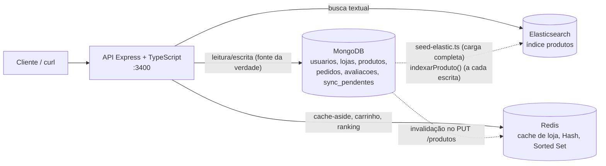

# Checkpoint 2 — Domingueira: arquitetura com MongoDB, Redis e Elasticsearch

> Como rodar do zero: `git clone <repo> && cd <repo> && ./iniciar.sh`. O script sobe os containers, carrega o Redis (`init/redis-init.commands`), **cria o índice `produtos` no Elasticsearch a partir do MongoDB** (`app/src/scripts/seed-elastic.ts`) e espera a API responder em `http://localhost:3400`. Não há passo manual.

---

## Seção 1 — Arquitetura e fonte da verdade



| Tipo de dado | Fonte da verdade (gravado primeiro) | Cópias | Por que existe a cópia |
|---|---|---|---|
| Usuários, lojas, produtos, pedidos, avaliações | **MongoDB** | Elasticsearch (só produtos, com nome da loja e bairro) | Busca textual com tolerância a erro e peso por campo, que o MongoDB não faz bem. |
| Página da loja (documento completo, com cardápio) | **MongoDB** (`lojas`) | **Redis** (`domingueira:loja:{slug}`, TTL 120 s) | A tela mais acessada: lida do Redis em ~2 ms. É descartável, pode ser reconstruída a qualquer momento. |
| Cardápio resumido dentro da loja | **MongoDB** (`produtos`) | `lojas.cardapio[]` (dentro do próprio MongoDB) | Mostrar o cardápio em uma só leitura. Atualizada na mesma rota de escrita. |
| Carrinho de compras (antes do pedido) | **Redis** (`domingueira:carrinho:{clienteId}`) | nenhuma | Dado temporário (24 h) e de alta escrita. Só vira dado durável quando o pedido é criado no MongoDB. Perder o carrinho não é grave. |
| Ranking de produtos mais vendidos | **MongoDB** (`pedidos` entregues) | **Redis** (`domingueira:ranking:produtos`, Sorted Set) | Ranking em tempo real sem agregar todos os pedidos a cada acesso. É derivado e pode ser recalculado a partir dos pedidos. |
| Índice de busca de produtos | **MongoDB** (`produtos` + `lojas`) | **Elasticsearch** (`produtos`) | Só existe para busca. Se for perdido, `seed-elastic.ts` reconstrói tudo a partir do MongoDB. |
| Fila de sincronização que falhou | **MongoDB** (`sync_pendentes`) | nenhuma | Precisa ser durável: se o Elasticsearch cair, o registro do que falta indexar não pode se perder junto. |

Regra geral: **toda escrita vai primeiro para o MongoDB**; Redis e Elasticsearch são derivados e reconstruíveis.

---

## Seção 2 — Redis como cache (cache-aside)

**Rota:** `GET /api/lojas/:slug` (`app/src/controllers/lojas.controller.ts`)

1. Consulta o Redis (`GET domingueira:loja:{slug}`). Se existe, devolve com `X-Cache: HIT`.
2. Se não existe, busca no MongoDB (`lojas.findOne({slug, ativa: true})`).
3. Grava no Redis com `SET ... EX 120` e devolve com `X-Cache: MISS`.

| Item | Valor |
|---|---|
| **Chave** | `domingueira:loja:{slug}`, por exemplo `domingueira:loja:assados-do-trianon` |
| **TTL** | **120 segundos** |
| **Motivo do TTL** | O cardápio muda poucas vezes por fim de semana, então 2 minutos já deixam a maioria das leituras no cache. Preço e disponibilidade não podem ficar defasados por muito tempo, e 2 minutos é o limite de erro aceitável. O TTL é a *rede de segurança*: se uma invalidação falhar ou alguém editar direto no banco, o dado errado some sozinho. |
| **Quando é invalidado** | Imediatamente, em `PUT /api/produtos/:id` e `POST /api/produtos` (comando `DEL` na chave da loja dona do produto), **depois** de gravar no MongoDB. Também expira sozinho após 120 s. |

---

## Seção 3 — Redis como estrutura de dados

Padrão de nomes: `domingueira:entidade:id`.

| Estrutura | Chave | Caso de uso real | Por que essa estrutura |
|---|---|---|---|
| **Hash** | `domingueira:carrinho:{clienteId}` (campo = `produto_id`, valor = quantidade) | Carrinho do cliente antes de fechar o pedido | O carrinho é um mapa produto → quantidade. `HINCRBY` soma/subtrai uma quantidade de forma atômica sem ler e reescrever, `HDEL` remove um item e `HGETALL` lê tudo. Com `String` seria preciso serializar um JSON inteiro e ler-modificar-gravar a cada clique, com risco de condição de corrida. O `EXPIRE` de 24 h apaga carrinhos abandonados. |
| **Sorted Set** | `domingueira:ranking:produtos` (membro = `produto_id`, score = vendidos) | "Mais vendidos" da home | Mantém a lista ordenada por score ao inserir. `ZINCRBY` incrementa quando um pedido é entregue e `ZREVRANGE ... WITHSCORES` devolve o top N em O(log N + N) sem agregar nenhum pedido. |
| **Set** | `domingueira:categorias:ativas` | Categorias válidas (carregado em `init/redis-init.commands`) | Pertencimento rápido com `SISMEMBER`, sem duplicatas. |
| **Hash** | `domingueira:config:app` | Configurações globais | Pequeno conjunto de campos nomeados. |

Rotas: `PUT|GET|DELETE /api/carrinho/:clienteId` e `GET /api/ranking/produtos` (`estruturas-redis.controller.ts`). O ranking é alimentado por `PATCH /api/pedidos/:id/status` quando o status vira `ENTREGUE`.

---

## Seção 4 — Elasticsearch: mapping e indexação

Arquivo: `init/elastic-init.json` (sem o parâmetro `boost`, que o ES 8 rejeita; os pesos ficam na consulta).

| Campo | Tipo | Justificativa |
|---|---|---|
| `nome`, `descricao`, `ingredientes`, `loja_nome` | **text** (analyzer `pt_sem_acento`) | O usuário *digita* esses campos. O analyzer quebra em termos, converte para minúsculas, remove acentos (`asciifolding`: "laticinio" acha "Laticínios"), tira stopwords e aplica stemming do português ("costela" e "costelinha" compartilham a raiz). |
| `categoria`, `alergenos`, `tipo_venda`, `bairro`, `cidade` | **keyword** | Valores exatos usados em **filtros** e agregações; não devem ser analisados ("Carnes" é uma categoria, não duas palavras). |
| `produto_id`, `loja_id`, `loja_slug` | **keyword** | Identificadores: só comparação exata. |
| `preco` | **float** | Filtro por faixa (`range`). |
| `disponivel` | **boolean** | Filtro de produtos ativos. |

**Como os documentos saem do MongoDB e chegam ao índice:**
- **Carga completa** (`seed-elastic.ts`, executado pelo `iniciar.sh`): apaga e recria o índice com o mapping do JSON, lê `produtos` e `lojas` do MongoDB, junta nome/slug/bairro da loja a cada produto (`montarDocumento`) e envia tudo com **bulk**. `ingredientes` (array) vira um texto único.
- **Incremental** (`services/sync-elastic.ts`): cada escrita de produto reindexa só aquele documento, relendo o estado atual do MongoDB (assim o índice sempre reflete o que está gravado).

---

## Seção 5 — Elasticsearch: busca

**Rota:** `GET /api/busca?q=...&categoria=...&preco_max=...&bairro=...&sem_alergeno=...` (`busca.controller.ts`)

```json
{
  "bool": {
    "must":   [{ "multi_match": { "query": "<q>", "fields": ["nome^3", "descricao^2", "ingredientes^1.5", "loja_nome"],
                                  "fuzziness": "AUTO", "prefix_length": 1 } }],
    "filter": [{ "term": { "disponivel": true } }, { "term": { "categoria": "..." } }, { "range": { "preco": { "lte": 50 } } }],
    "must_not": [{ "term": { "alergenos": "..." } }]
  }
}
```

| Campo | Peso | Motivo |
|---|---|---|
| `nome` | **3** | Quem busca "frango" quer um produto que *seja* frango. O nome é o sinal mais forte de intenção. |
| `descricao` | **2** | Contém o contexto ("forno a lenha", "fogo de chão"), segundo sinal mais importante. |
| `ingredientes` | **1,5** | Ajuda a achar por ingrediente, mas um produto *com* alho não é um produto *de* alho. |
| `loja_nome` | 1 | Permite buscar pelo nome da loja, com a menor relevância. |

- **Tolerância a erro de digitação:** `fuzziness: "AUTO"` aceita 1 a 2 letras trocadas, conforme o tamanho da palavra. `prefix_length: 1` exige a primeira letra correta, o que reduz resultados absurdos e custo.
- **Filtro exato:** `bool.filter` com `term` (categoria, bairro, disponibilidade) e `range` (preço). Filtros não entram no score e são cacheáveis pelo Elasticsearch.

---

## Seção 6 — Integração e sincronização

**Rota de escrita:** `PUT /api/produtos/:id` (e `POST /api/produtos`), em `produtos.controller.ts`. Ordem das operações:

1. **MongoDB**: atualiza `produtos` e a cópia embutida em `lojas.cardapio` (`arrayFilters`). Se falhar aqui, nada mais acontece.
2. **Elasticsearch**: `sincronizarProduto()` relê o produto e reindexa com `refresh: wait_for` (a busca enxerga o dado na hora). Se falhar, grava o produto em `sync_pendentes`.
3. **Redis**: `DEL domingueira:loja:{slug}`.

**1. Depois de uma alteração, em quanto tempo a busca e o cache passam a mostrar o dado novo?**
- **Cache:** imediatamente. A chave é apagada na própria requisição, e a próxima leitura é um `MISS` que busca o dado novo no MongoDB. Se o `DEL` falhar (Redis fora), o dado antigo vive no máximo **120 s** (o TTL).
- **Busca:** imediatamente. O `refresh: wait_for` só devolve a resposta depois que o documento fica visível para busca. Sem essa opção seria até 1 s (intervalo padrão de refresh do Elasticsearch).

**2. O que acontece se a gravação no MongoDB der certo e a atualização do Elasticsearch falhar?**
O MongoDB é a fonte da verdade, então a alteração **não é desfeita**. A API responde 200 com `"elasticsearch": "PENDENTE (...)"`, o `produto_id` é registrado na coleção durável `sync_pendentes` (com o erro e o número de tentativas) e o cache é invalidado normalmente. Até a recuperação, a *busca* mostra o dado antigo, mas a *leitura direta* (loja, carrinho) já mostra o novo. Para recuperar: `POST /api/sync/reprocessar` reindexa tudo o que está na fila e a remove quando dá certo. Como último recurso, `seed-elastic.ts` reconstrói o índice inteiro a partir do MongoDB. Sem transação distribuída entre os bancos, o que se garante é **consistência eventual com recuperação explícita**, e a fonte da verdade nunca fica errada.

*Limitação conhecida:* se a própria API cair entre o passo 1 e o 2, nada fica registrado em `sync_pendentes`. Nesse caso `seed-elastic.ts` (ou um `reprocessar` seguido de um reseed periódico) corrige. Uma solução mais robusta seria um *outbox* gravado na mesma operação do MongoDB.

---

## Seção 7 — Roteiro de demonstração

Pré-requisito: ambiente recém-iniciado com `./iniciar.sh`. Rode os comandos **na ordem**. Os IDs são fixos (vêm do `init/mongo-init.js`). Os tempos variam um pouco.

```bash
B=http://localhost:3400/api
```

### 7.1 Primeira leitura (sem cache) e segunda (com cache)
```bash
curl -s -o /dev/null -D - -w 'tempo: %{time_total}s\n' $B/lojas/assados-do-trianon | grep -i 'x-cache\|tempo'
```
```
X-Cache: MISS
tempo: 0.009778s
```
```bash
curl -s -o /dev/null -D - -w 'tempo: %{time_total}s\n' $B/lojas/assados-do-trianon | grep -i 'x-cache\|tempo'
```
```
X-Cache: HIT
tempo: 0.001808s
```
```bash
docker exec nosql_redis redis-cli TTL domingueira:loja:assados-do-trianon
```
```
120        (valor entre 1 e 120, conforme o tempo decorrido)
```

### 7.2 Estruturas do Redis (Hash e Sorted Set)
```bash
curl -s -X PUT $B/carrinho/670a1b9d8f3b4a5d6e7f8910/itens -H 'Content-Type: application/json' -d '{"produto_id":"670a1d4f8f3b4a5d6e7f8b01","quantidade":2}'
curl -s -X PUT $B/carrinho/670a1b9d8f3b4a5d6e7f8910/itens -H 'Content-Type: application/json' -d '{"produto_id":"670a1d4f8f3b4a5d6e7f8b03","quantidade":1}'
```
```
{"estrutura":"HASH","chave":"domingueira:carrinho:670a1b9d8f3b4a5d6e7f8910","produto_id":"670a1d4f8f3b4a5d6e7f8b01","quantidade_no_carrinho":2}
{"estrutura":"HASH","chave":"domingueira:carrinho:670a1b9d8f3b4a5d6e7f8910","produto_id":"670a1d4f8f3b4a5d6e7f8b03","quantidade_no_carrinho":1}
```
```bash
curl -s $B/carrinho/670a1b9d8f3b4a5d6e7f8910
```
```
{"estrutura":"HASH","chave":"domingueira:carrinho:670a1b9d8f3b4a5d6e7f8910","ttl_segundos":86400,"itens":[{"produto_id":"670a1d4f8f3b4a5d6e7f8b01","nome":"Frango assado inteiro","quantidade":2,"preco_unitario":52,"subtotal":104},{"produto_id":"670a1d4f8f3b4a5d6e7f8b03","nome":"Maionese caseira 500 g","quantidade":1,"preco_unitario":16,"subtotal":16}],"total":120}
```
```bash
docker exec nosql_redis redis-cli HGETALL domingueira:carrinho:670a1b9d8f3b4a5d6e7f8910
```
```
670a1d4f8f3b4a5d6e7f8b01
2
670a1d4f8f3b4a5d6e7f8b03
1
```
```bash
curl -s "$B/ranking/produtos?top=3"
```
```
{"estrutura":"SORTED SET","chave":"domingueira:ranking:produtos","ranking":[{"posicao":1,"produto_id":"670a1d4f8f3b4a5d6e7f8b01","nome":"Frango assado inteiro","vendidos":41},{"posicao":2,"produto_id":"670a1d4f8f3b4a5d6e7f8b02","nome":"Costela bovina fogo de chão","vendidos":33},{"posicao":3,"produto_id":"670a1d4f8f3b4a5d6e7f8b11","nome":"Cuca de banana com farofa","vendidos":29}]}
```

### 7.3 Busca com erro de digitação
```bash
curl -s "$B/busca?q=fraango"
```
```
{"origem":"ELASTICSEARCH","termo":"fraango","total":3,"resultados":[{"score":4.68,"produto":"Frango assado inteiro","loja":"Assados do Trianon","categoria":"Aves","preco":52,"tipo_venda":"UNIDADE","bairro":"Trianon"},{"score":3.74,"produto":"Espeto de coração de frango (5 un)","loja":"Churrasqueira do Rogério","categoria":"Espetos","preco":22,"tipo_venda":"UNIDADE","bairro":"Batel"},{"score":2.31,"produto":"Marmita rural completa","loja":"Cozinha da Neusa","categoria":"Pratos","preco":28,"tipo_venda":"UNIDADE","bairro":"Boqueirão"}]}
```
"fraango" (errado) encontra "Frango"; o produto com "frango" no **nome** pontua mais (peso 3) do que o que só tem no ingrediente.

### 7.4 Busca com filtro exato
```bash
curl -s "$B/busca?q=costela&categoria=Carnes&preco_max=50"
```
```
{"origem":"ELASTICSEARCH","termo":"costela","total":1,"resultados":[{"score":2.84,"produto":"Costelinha suína barbecue","loja":"Porcão da Vila","categoria":"Carnes","preco":46,"tipo_venda":"UNIDADE","bairro":"Vila Carli"}]}
```
A "Costela bovina fogo de chão" (R$ 84,90/kg) casa com o texto, mas o filtro `preco ≤ 50` a exclui.

### 7.5 Alteração de um registro, seguida de nova busca e nova leitura
```bash
curl -s -X PUT $B/produtos/670a1d4f8f3b4a5d6e7f8b01 -H 'Content-Type: application/json' -d '{"preco":59.9,"descricao":"Frango caipira assado no forno a lenha com farofa de miúdos, edição de domingo."}'
```
```
{"mensagem":"Produto atualizado no MongoDB.","elasticsearch":"REINDEXADO","cache_redis":"INVALIDADO","dados":{"_id":"670a1d4f8f3b4a5d6e7f8b01","loja_id":"670a1c2e8f3b4a5d6e7f8a01","nome":"Frango assado inteiro","categoria":"Aves","descricao":"Frango caipira assado no forno a lenha com farofa de miúdos, edição de domingo.", ... ,"venda":{"tipo":"UNIDADE","preco":59.9}, ... }}
```
```bash
curl -s "$B/busca?q=frango+assado&categoria=Aves"
```
```
{"origem":"ELASTICSEARCH","termo":"frango assado","total":1,"resultados":[{"score":10.99,"produto":"Frango assado inteiro","loja":"Assados do Trianon","categoria":"Aves","preco":59.9,"tipo_venda":"UNIDADE","bairro":"Trianon"}]}
```
```bash
curl -s -o /dev/null -D - $B/lojas/assados-do-trianon | grep -i x-cache
curl -s $B/lojas/assados-do-trianon | python3 -c "import sys,json; print(json.dumps(json.load(sys.stdin)['dados']['cardapio'][0], ensure_ascii=False))"
```
```
X-Cache: MISS
{"produto_id": "670a1d4f8f3b4a5d6e7f8b01", "nome": "Frango assado inteiro", "venda": {"tipo": "UNIDADE", "preco": 59.9}, "estoque": {"limitado": true}, "detalhes": {"recheio": "Farofa de miúdos", "tempero": "Alho e limão"}, "ativo": true}
```
O `MISS` prova que o cache foi invalidado, e o preço novo (59,9) aparece na leitura direta e na busca.

### 7.6 (Extra) Falha do Elasticsearch e recuperação
```bash
docker stop nosql_elasticsearch
curl -s -X PUT $B/produtos/670a1d4f8f3b4a5d6e7f8b04 -H 'Content-Type: application/json' -d '{"preco":41.5}' | python3 -c "import sys,json; d=json.load(sys.stdin); print(d['mensagem'], '|', d['elasticsearch'], '|', d['cache_redis'], '|', d['dados']['venda']['preco'])"
```
```
Produto atualizado no MongoDB. | PENDENTE (getaddrinfo EAI_AGAIN elasticsearch) | INVALIDADO | 41.5
```
```bash
docker start nosql_elasticsearch && sleep 20       # aguarde o Elasticsearch voltar
curl -s -X POST $B/sync/reprocessar
curl -s "$B/busca?q=arroz+carreteiro" | python3 -c "import sys,json; print(json.load(sys.stdin)['resultados'][0]['preco'])"
```
```
{"encontrados":1,"sincronizados":1,"ainda_pendentes":0}
41.5
```

### 7.7 (Extra) Atualização atômica de status e ranking
```bash
curl -s -X PATCH $B/pedidos/670a30008f3b4a5d6e7f8c07/status -H 'Content-Type: application/json' -d '{"status":"ENTREGUE"}'
```
```
{"erro":"Pedido inexistente ou não pode ir para ENTREGUE a partir do status atual."}
```
```bash
curl -s -X PATCH $B/pedidos/670a30008f3b4a5d6e7f8c07/status -H 'Content-Type: application/json' -d '{"status":"PRONTO"}' | python3 -c "import sys,json; d=json.load(sys.stdin); print(d['mensagem'], [h['status'] for h in d['dados']['historico']])"
curl -s -X PATCH $B/pedidos/670a30008f3b4a5d6e7f8c07/status -H 'Content-Type: application/json' -d '{"status":"ENTREGUE"}' | python3 -c "import sys,json; print(json.load(sys.stdin)['mensagem'])"
curl -s "$B/ranking/produtos?top=2"
```
```
Pedido atualizado para PRONTO. ['PENDENTE', 'CONFIRMADO', 'PRONTO']
Pedido atualizado para ENTREGUE.
{"estrutura":"SORTED SET","chave":"domingueira:ranking:produtos","ranking":[{"posicao":1,"produto_id":"670a1d4f8f3b4a5d6e7f8b01","nome":"Frango assado inteiro","vendidos":43},{"posicao":2,"produto_id":"670a1d4f8f3b4a5d6e7f8b02","nome":"Costela bovina fogo de chão","vendidos":33}]}
```
(O pedido 7 tinha 2 frangos: o score do frango passou de 41 para 43. Depois de 7.7, o ranking e os pedidos ficam alterados; para repetir o roteiro do zero use `./reset.sh`.)
